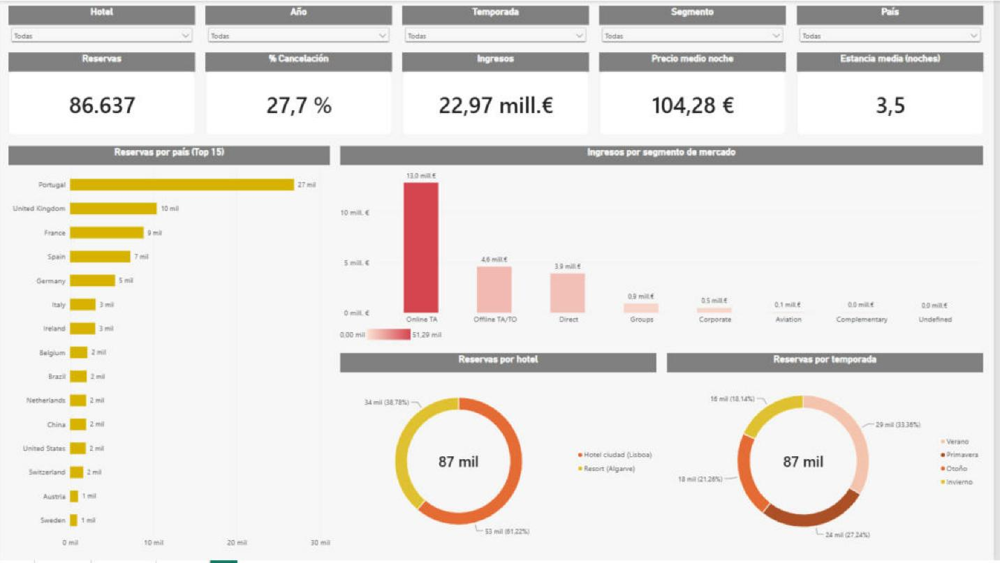
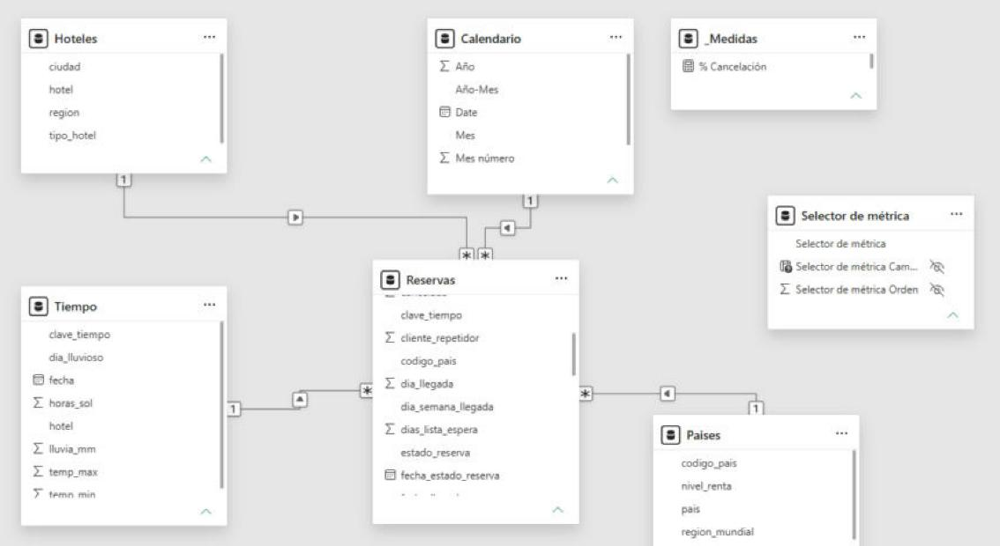
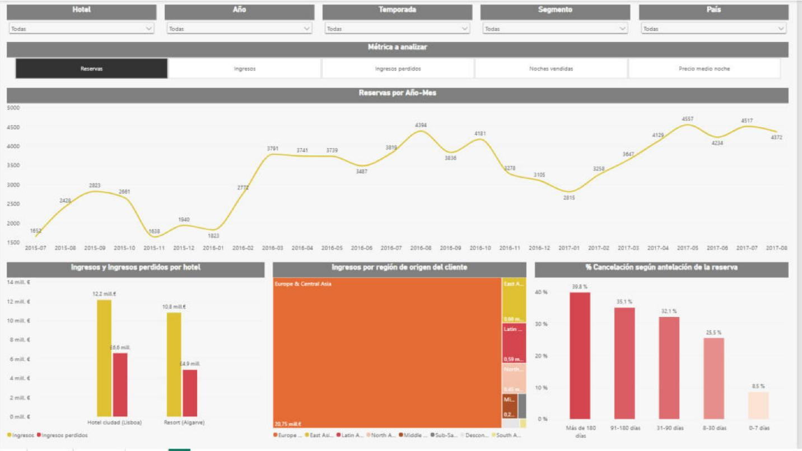
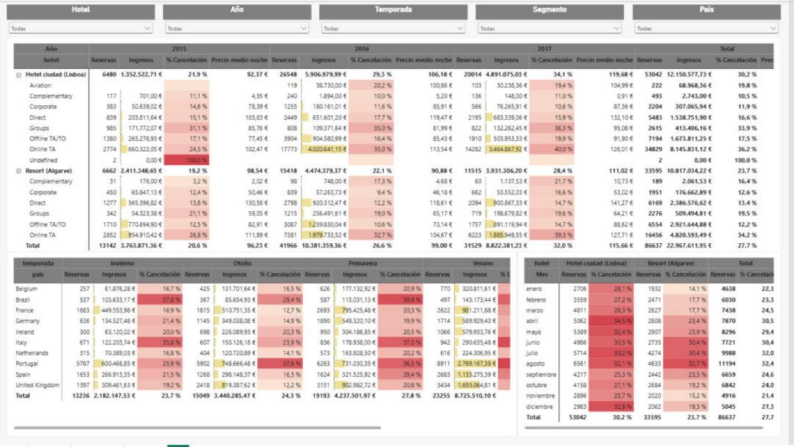
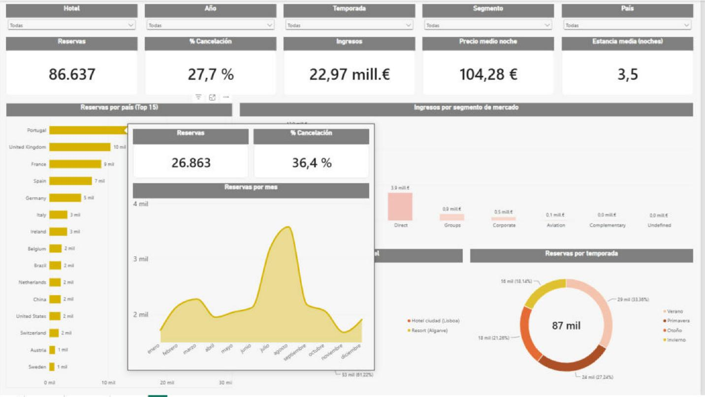

# DataProject: Proyecto Final. Reservas hoteleras en Portugal



## 1. Descripción del proyecto

Proyecto final del curso **Data & Analytics V3 de thePower**. Se analizan las reservas de dos hoteles portugueses, un **hotel de ciudad en Lisboa** y un **resort en el Algarve**, con llegadas entre julio de 2015 y agosto de 2017. El objetivo es saber cómo se comporta la demanda, de qué dependen los precios y, sobre todo, **por qué se cancelan tantas reservas**.

El trabajo tiene dos partes:

- **EDA en Python (pandas)**: limpieza, unión de fuentes, análisis descriptivo y contrastes estadísticos.
- **Dashboard en Power BI**: modelo en estrella, medidas DAX y un informe de 4 páginas (Dashboard, Análisis, Reporting y Tooltip).

Con el proyecto se demuestran estos conocimientos:

- Carga, limpieza y transformación de datos con pandas (duplicados, nulos, valores anómalos y tipos de datos).
- Creación de variables nuevas y unión (`merge`) de varias fuentes de datos.
- Análisis descriptivo y visualización con matplotlib y seaborn.
- Estadística inferencial: normalidad, intervalos de confianza, prueba t, ANOVA, chi-cuadrado y correlación.
- Modelado de datos en Power BI (modelo en estrella), Power Query, DAX, segmentadores sincronizados, parámetro de campo y página de tooltip.
- Comunicación de resultados en un informe profesional.

**Herramientas:** Python 3, Visual Studio Code, Jupyter Notebook, pandas, numpy, matplotlib, seaborn, scipy y Power BI Desktop.

## 2. Fuentes de datos

| Fuente | Contenido | Tamaño original | Cómo se une |
|---|---|---|---|
| [Hotel Booking Demand](https://www.kaggle.com/datasets/jessemostipak/hotel-booking-demand) (Kaggle) | Reservas de los dos hoteles: fechas, antelación, segmento, canal, precio, depósito, cancelación... | 119.390 filas × 32 columnas | Tabla principal |
| [Banco Mundial. PIB per cápita (NY.GDP.PCAP.CD)](https://data.worldbank.org/indicator/NY.GDP.PCAP.CD) | PIB per cápita por país y año, región y nivel de renta (archivos de metadatos) | 266 países | Código de país (ISO-3) + año de llegada |
| [Open-Meteo. Historical Weather API](https://open-meteo.com/en/docs/historical-weather-api) | Temperatura máxima y mínima, lluvia y horas de sol diarias de Lisboa y del Algarve | 2 archivos diarios | Hotel + fecha de llegada |

Después de la limpieza y la unión, el conjunto final tiene **86.637 filas y 51 columnas**.

## 3. Estructura del proyecto

```
DataProject-Proyecto-Final/
├── data/
│   ├── raw/                          # Datos originales sin modificar (3 orígenes)
│   │   ├── hotel_bookings.csv
│   │   ├── API_NY.GDP.PCAP.CD_DS2_en_csv_v2_260096.csv
│   │   ├── Metadata_Country_API_NY.GDP.PCAP.CD_DS2_en_csv_v2_260096.csv
│   │   ├── Metadata_Indicator_API_NY.GDP.PCAP.CD_DS2_en_csv_v2_260096.csv
│   │   ├── tiempo_lisboa.csv.csv
│   │   └── tiempo_algarve.csv.csv
│   └── processed/                    # Datos limpios y unidos (los genera el notebook 01)
│       ├── hotel_bookings_final.zip  # Conjunto final comprimido (86.637 × 51)
│       ├── dim_paises.csv            # Dimensiones para el modelo en estrella de Power BI
│       ├── dim_hoteles.csv
│       └── dim_tiempo.csv
├── notebooks/
│   ├── 01_limpieza_y_union.ipynb                  # Limpieza, variables nuevas y unión de fuentes
│   └── 02_analisis_descriptivo_y_estadistico.ipynb # EDA, gráficos y contrastes estadísticos
├── img/                              # Gráficos generados por el notebook 02
├── dashboard/
│   ├── dashboard_reservas_hotel.pbix # Informe de Power BI
│   └── capturas/                     # Capturas de las páginas del informe y del modelo
├── informe/
│   └── Estudio_reservas_hoteleras_Carlos_Luque.pdf # Estudio con conclusiones y recomendaciones
├── requirements.txt
└── README.md
```

> El archivo `hotel_bookings_final.csv` ocupa 27 MB y la web de GitHub solo admite archivos de hasta 25 MB, así que se sube comprimido en `hotel_bookings_final.zip`. También se puede volver a generar ejecutando el notebook 01.

## 4. Cómo ejecutar el proyecto

1. Clonar o descargar el repositorio.
2. Instalar las librerías:
   ```bash
   pip install -r requirements.txt
   ```
3. Abrir la carpeta en VSCode (con las extensiones de Python y Jupyter) y seleccionar el intérprete de Python 3.
4. Ejecutar **`notebooks/01_limpieza_y_union.ipynb`** (Run All). Lee `data/raw/` y crea los archivos de `data/processed/`.
5. Ejecutar **`notebooks/02_analisis_descriptivo_y_estadistico.ipynb`**. Guarda los gráficos en `img/`.
6. Abrir **`dashboard/dashboard_reservas_hotel.pbix`** con Power BI Desktop. Si los datos no cargan, hay que cambiar la ruta de los CSV en *Transformar datos → Configuración de origen de datos* para que apunte a la carpeta `data/processed` del equipo.

## 5. Proceso de trabajo

### 5.1 Limpieza y unión (notebook 01)

- Se eliminan **31.994 duplicados**, 166 reservas sin huéspedes, 591 reservas de 0 noches y 2 precios anómalos (negativo o mayor de 1.000 €).
- Nulos: los niños vacíos pasan a 0 y el país vacío a "Desconocido"; agencia y empresa se convierten en indicadores sí/no. También se corrigen códigos de país (CN → CHN, TMP → TLS).
- Variables nuevas: fecha de llegada y de salida, total de noches y de huéspedes, ingreso de la reserva (precio × noches), ingreso real (solo reservas no canceladas), temporada, día de la semana, grupo de antelación y habitación cambiada.
- Columnas traducidas al español.
- Uniones:
  - Banco Mundial por código de país + año.
  - Open-Meteo por hotel + fecha de llegada.
- Exportación de las tablas de dimensiones para el modelo en estrella de Power BI.

### 5.2 Análisis descriptivo y estadístico (notebook 02)

- KPIs, estadísticos descriptivos, asimetría y curtosis, y gráficos de distribución, evolución mensual, países, cancelaciones y correlaciones.
- Contrastes (α = 0,05):

| Pregunta | Prueba | Resultado |
|---|---|---|
| ¿El precio por noche es normal? | Shapiro-Wilk | No (p ≈ 0) |
| Precio medio por noche | Intervalo de confianza 95 % | 107,18 € [106,84 – 107,53] |
| ¿El precio es distinto entre hoteles? | t de Welch | Sí: 111,66 € en la ciudad frente a 100,12 € en el resort |
| ¿El precio cambia con la temporada? | ANOVA | Sí: de 76,5 € en invierno a 138,1 € en verano |
| ¿La cancelación depende del hotel? | Chi-cuadrado | Sí: 30,2 % frente a 23,7 % |
| ¿La cancelación depende del depósito? | Chi-cuadrado | Sí: los depósitos no reembolsables cancelan un 94,7 % |
| ¿Las canceladas se reservan con más antelación? | t de Welch | Sí: 105,8 días frente a 70,5 días |
| ¿El precio depende de la renta del país? | Kruskal-Wallis y correlación | Sí, pero la relación es muy débil (r = 0,05) |
| ¿El precio sube con la temperatura en el resort? | Correlación de Pearson | Sí, r = 0,67 |

### 5.3 Dashboard en Power BI



- **Modelo en estrella**:
  - Tabla de hechos: `Reservas`.
  - Dimensiones: `Calendario` (creada con DAX), `Hoteles`, `Paises` y `Tiempo`.
- **Tabla `_Medidas`** con todas las medidas DAX, que se construyen unas a partir de otras (por ejemplo, `% Cancelación = DIVIDE([Reservas canceladas], [Reservas])`).
- Páginas de **1920 × 1080**:
  - **Dashboard**: KPIs, países, segmentos, hoteles y temporadas.
  - **Análisis**: evolución mensual con un **parámetro de campo** para elegir la métrica, ingresos frente a ingresos perdidos, regiones de origen y cancelación según la antelación.
  - **Reporting**: matrices con formato condicional por hotel, segmento, año, país, temporada y mes.
  - **Tooltip** (500 × 500): resumen que aparece al pasar el ratón por los gráficos del Dashboard.
- Segmentadores de Hotel, Año, Temporada, Segmento y País en la parte superior, **sincronizados** entre páginas, y los mismos colores y formatos en todos los objetos visuales.

| Análisis | Reporting | Tooltip |
|---|---|---|
|  |  |  |

## 6. Resultados destacados

- **86.637 reservas**, **22,97 M€** de ingresos, **104,28 €** de precio medio por noche y **3,5 noches** de estancia media.
- **El 27,7 % de las reservas se cancela.** El importe cancelado (**11,48 M€**) equivale al 50 % de lo ingresado.
- **La cancelación va en aumento.** Comparando solo julio y agosto, pasa del 26,5 % (2015) al 30,8 % (2016) y al 36,1 % (2017), aunque las reservas crecen.
- **Agencias online (Online TA):** generan el 56 % de los ingresos, cancelan el 35,5 % de sus reservas y suman el **81 % de los ingresos perdidos**.
- **Antelación:** las reservas hechas con más de 180 días se cancelan un 39,8 %; las de la última semana, solo un 8,5 %.
- **Precios del resort:** van de unos 50 € en enero a 189 € en agosto y siguen a la temperatura (r = 0,67).
- **Portugal:** es el primer mercado (31 % de las reservas) y el que más cancela (36,4 %).
- **Clientes que casi no cancelan:** los repetidores (8,2 %) y los que piden plaza de parking (0 %).

El estudio completo, con recomendaciones y limitaciones, está en [`informe/Estudio_reservas_hoteleras_Carlos_Luque.pdf`](informe/Estudio_reservas_hoteleras_Carlos_Luque.pdf).

## 7. Buenas prácticas aplicadas

- Estructura de carpetas: datos originales en `raw/` sin tocar y datos procesados en `processed/`.
- Notebooks numerados en orden de ejecución, divididos en secciones con títulos y explicaciones en markdown.
- Rutas relativas (`../data/raw/`) para que el proyecto funcione en cualquier equipo.
- Todos los `import` al principio y nombres de variables descriptivos en español.
- Cada decisión de limpieza se comprueba mostrando cuántas filas se eliminan.
- En Power BI: tabla de medidas, medidas reutilizadas, columnas duplicadas eliminadas, modelo en estrella y formatos homogéneos.

## 8. Autoría

Carlos Luque Camacho
